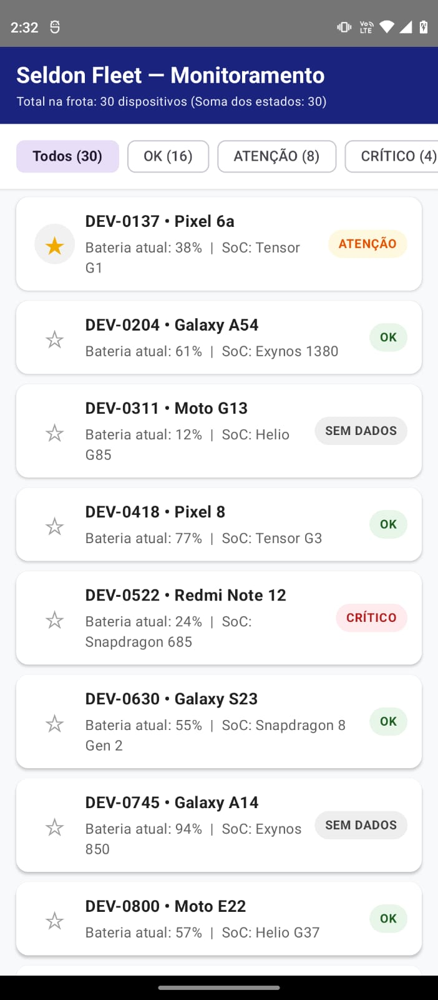
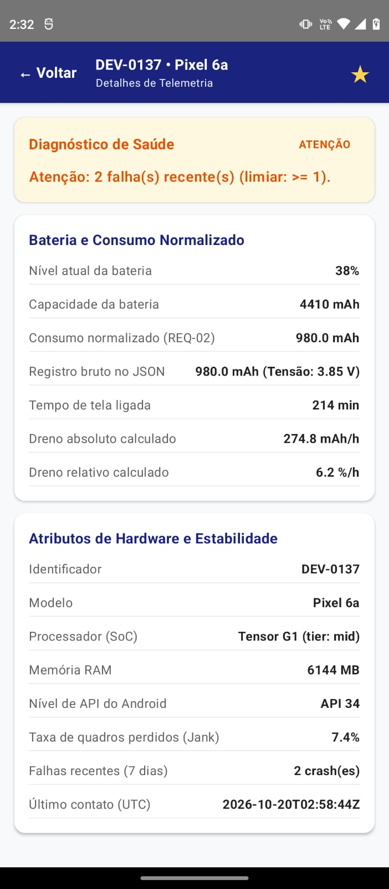

# Seldon Fleet — Monitoramento e Diagnóstico de Telemetria Android

Aplicação Android nativa desenvolvida em **Kotlin** e **Jetpack Compose** para o desafio técnico do **Projeto Seldon — Residência em Software e Sistemas Móveis (UEA/Motorola)**.

O aplicativo realiza a ingestão 100% offline de telemetria da frota a partir de `assets/frota.json` (`30 dispositivos`), normaliza grandezas físicas inconsistentes (`mWh` -> `mAh`), protege contra divisões por zero em registros defeituosos e classifica a saúde operacional de cada aparelho (`OK`, `ATENÇÃO`, `CRÍTICO` e `SEM DADOS`) por meio de uma regra de negócio isolada em `domain/` (Kotlin puro) e validada por testes unitários na JVM.

---

## 1. Como Executar o Projeto e Rodar os Testes

### Pré-requisitos
* **Android Studio** (Ladybug / Koala ou superior)
* **JDK 17** configurado no Gradle
* Dispositivo Android físico (API 26+) ou Emulador

### Comandos Principais de Verificação
* **Rodar a suíte de testes unitários na JVM (sem emulador — `REQ-08`):**
   * Linux/macOS: `./gradlew testDebugUnitTest`
   * Windows: `.\gradlew.bat testDebugUnitTest`
* **Rodar a análise estática de código (`REQ-09`):**
   * Linux/macOS: `./gradlew lintDebug`
   * Windows: `.\gradlew.bat lintDebug`
* **Verificar a pureza arquitetural da camada `domain/` (`REQ-04`):**
   * `grep -r "import android" app/src/main/java/com/seldon/fleet/domain/` (Retorna vazio: zero dependências do Android no domínio).

---

## 2. Capturas de Tela (Seção 8)

| Tela 1 — Lista da Frota, Filtros com Contagem e Favoritos (`REQ-05`, `REQ-07`) | Tela 2 — Detalhe do Dispositivo e Justificativa Textual (`REQ-06`) |
| :---: | :---: |
|  |  |

### Resumo dos Resultados nos 30 Dispositivos de `assets/frota.json`
* **Total de dispositivos carregados em Modo Avião (`REQ-01`):** `30`
* **Soma das contagens por estado nos filtros (`REQ-05`):** `16 (OK) + 8 (ATENÇÃO) + 4 (CRÍTICO) + 2 (SEM DADOS) = 30`
* **Registros com Defeito 1 (`energyUnit = "mWh"` convertidos via `nominalVoltage` — `REQ-02`):** `10 dispositivos` (`DEV-0204`, `DEV-0522`, `DEV-0630`, `DEV-0854`, `DEV-1142`, `DEV-1214`, `DEV-1422`, `DEV-1546`, `DEV-1582`, `DEV-1924`).
* **Registros com Defeito 2 (divisores zerados classificados como `INDETERMINADO` / `SEM DADOS` — `REQ-03`):** `2 dispositivos` (`DEV-0311` com `batteryCapacityMah = 0`; `DEV-0745` com `screenOnMinutes = 0`).

---

## 3. Arquitetura, Decisões de Projeto e Trade-offs (Seção 6 e Seção 8)

O projeto segue uma arquitetura em três camadas com **Inversão de Dependência** (as dependências apontam para dentro, em direção ao domínio):

* **`domain/` (Kotlin Puro):** Contém as entidades (`Device`, `DeviceStatus`), o contrato `DeviceRepository` e os casos de uso (`ClassifyDevice` e `FleetPercentileClassifier`). Não possui nenhum `import android.*`.
* **`data/` (Infraestrutura e Dados):** Contém o DTO bruto (`DeviceDto`), o conversor físico de unidades (`DeviceMapper`), o leitor local (`AssetFleetSource`) e a implementação do repositório (`FleetRepositoryImpl`) com `DataStore<Preferences>`.
* **`ui/` (Apresentação em Jetpack Compose):** Contém o `FleetListViewModel`, a Tela 1 (`FleetListScreen`) e a Tela 2 (`DeviceDetailScreen`).

### Trade-offs Aceitos
1. **Pacotes em Módulo Único vs. Múltiplos Módulos Gradle:** Adotou-se a divisão por pacotes dentro do módulo `:app` (conforme Anexo B) para manter a compilação rápida e enxuta, garantindo o isolamento de `domain/` por verificação estática de imports (`REQ-04`).
2. **Classificação de Registros Incompletos como `INDETERMINADO` vs. Exclusão:** Manter os registros defeituosos na lista com o estado `INDETERMINADO` (`SEM DADOS` na UI) evita `NaN`/`Infinity`, alerta o operador sobre falhas de telemetria e preserva a invariante do `REQ-05` (soma das contagens igual aos 30 registros do arquivo).
3. **Navegação por Estado no `ViewModel` + `BackHandler` vs. `Navigation Compose`:** Para um escopo estrito de duas telas, controlar o item selecionado no `FleetListViewModel` garante por construção que o filtro ativo na Tela 1 jamais seja perdido ao retornar da Tela 2 (`REQ-06`).
4. **`DataStore<Preferences>` vs. `Room`:** Como `frota.json` é a única fonte da verdade relida a cada abertura e apenas os IDs favoritados precisam persistir (`REQ-07`), o `DataStore` atende ao requisito sem introduzir banco relacional fora de escopo (Seção 2.4).

---

## 4. Trilha de Especialização: Trilha A — IA Aplicada à Otimização (Seção 10)

Foi implementada em `domain/usecase/FleetPercentileClassifier.kt` uma segunda estratégia **orientada por dados (*Data-Driven*)**, baseada nos **Percentis Empíricos P75 e P90** do dreno relativo da frota e no percentil P85 de *jank* agrupado por `tier` de SoC (`low`, `mid`, `high`).

### Comparação entre a Regra de Referência (Fixa) e a Trilha A nos 30 Aparelhos
Nos 28 dispositivos válidos de `frota.json`, a distribuição empírica de dreno relativo possui mediana de `6,25 %/h`, **P75 = `9,77 %/h`** e **P90 = `13,38 %/h`**.

| Dispositivo | Modelo (`tier`) | Dreno Relativo | Crashes / Jank | Regra de Referência (Fixa) | Trilha A (`FleetPercentileClassifier`) | Análise Técnica |
| :--- | :--- | :---: | :---: | :---: | :---: | :--- |
| `DEV-0311` | Moto G13 (`low`) | Divisor `0` | `1` / `11,2%` | `INDETERMINADO` | `INDETERMINADO` | **Concordância:** Divisão por zero bloqueada. |
| `DEV-0745` | Galaxy A14 (`low`) | Divisor `0` | `0` / `0,0%` | `INDETERMINADO` | `INDETERMINADO` | **Concordância:** Divisão por zero bloqueada. |
| `DEV-1514` | Moto G13 (`low`) | `7,42 %/h` | `0` / `2,4%` | `ATENCAO` | **`OK`** | **Trilha A erra menos:** Aparelho de entrada sem crashes e com jank baixo (`2,4%`), apenas `0,42%/h` acima do limiar fixo de `7%/h`, mas abaixo do P75 da frota (`9,77%/h`). |
| `DEV-1625` | Moto G13 (`low`) | `7,58 %/h` | `0` / `2,9%` | `ATENCAO` | **`OK`** | **Trilha A erra menos:** Comportamento normal para a frota, reduzindo falsos alertas (*alarm fatigue*). |
| `DEV-0522` | Redmi Note 12 (`low`) | `13,40 %/h` | `1` / `9,8%` | `CRITICO` | `CRITICO` | **Concordância:** Acima do P90 da frota (`13,38%/h`). |
| `DEV-1985` | Galaxy A04e (`low`) | `13,50 %/h` | `0` / `2,0%` | `CRITICO` | `CRITICO` | **Concordância:** Acima do P90 da frota. |
| `DEV-1839` | Pixel 6a (`mid`) | `19,40 %/h` | `0` / `5,9%` | `CRITICO` | `CRITICO` | **Concordância:** Anomalia severa no topo da distribuição. |

* **Qual erra menos e por quê:** A implementação da **Trilha A (`FleetPercentileClassifier`)** erra menos na zona intermediária (`7,0 %/h` a `9,7 %/h`), evitando classificar como `ATENCAO` aparelhos sem falhas como `DEV-1514` (`7,42 %/h`) e `DEV-1625` (`7,58 %/h`), cujo consumo é normal dentro da distribuição empírica da frota (< P75). Por outro lado, limiares fixos continuam úteis como teto de segurança absoluta caso toda a frota sofra uma regressão simultânea de bateria.

---

## 5. O Que Eu Faria em Seguida (Limitações e Próximos Passos — Seção 8)

1. **Desacoplamento do Consumo em Tela Ligada vs. Tela Desligada (*Background Drain*):** Como registrado no `PROTOCOLO.md`, dividir todo o consumo (`energyConsumed`) apenas por `screenOnMinutes` superestima o dreno de aparelhos com serviços intensos em segundo plano e tela apagada. O próximo passo seria separar no JSON de telemetria `screenOnEnergyMah` e `screenOffEnergyMah`.
2. **Compensação pela Curva Real de Tensão e Temperatura:** Substituir a tensão nominal estática (`nominalVoltage`) pela tensão média amostrada durante a descarga e incluir a temperatura da bateria no classificador da Trilha A.
3. **Testes Automatizados de Interface (`ComposeTestRule`):** Adicionar testes instrumentados para verificar automaticamente a preservação do estado do filtro ao navegar entre as telas (`REQ-06`).

---

## 6. Declaração de Uso de Inteligência Artificial (Seção 11)

Em conformidade com a Seção 11 da especificação técnica:
* **Onde a IA foi utilizada:** Utilizei o assistente Gemini como mentor técnico e ferramenta de apoio para revisar conceitos da linguagem Kotlin, estruturar os componentes declarativos em Jetpack Compose, configurar a persistência com `DataStore` e redigir o workflow de integração contínua (`ci.yml`).
* **Qual parte do raciocínio, decisões e validação é minha:** A análise dos 30 registros do arquivo `frota.json`, a tomada das decisões arquiteturais e de tratamento de defeitos registradas no `PROTOCOLO.md`, a formulação física das ameaças à validade (impacto de consumo em *background* e variação da tensão na conversão `mWh` -> `mAh`), a comparação analítica da Trilha A, bem como a execução dos testes na JVM e os testes práticos em aparelho físico Android em Modo Avião foram realizados e verificados por mim.